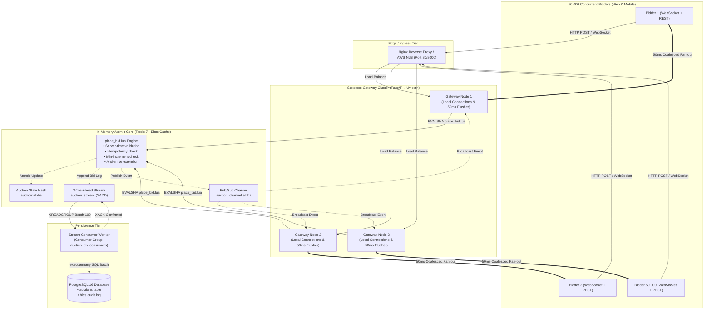

# System Architecture & Request Flow (ARCHITECTURE.md)

## 1. High-Level System Architecture Diagram

---

## 2. End-to-End Bid Life Cycle (Sequence Breakdown)

### Step 1: Ingress & Overload Protection
1. A client initiates a bid with a client-generated UUID (`bid_id`), user identifier, and proposed amount.
2. The request reaches the Nginx load balancer (or AWS NLB) and is routed to one of the stateless FastAPI gateway instances.
3. The gateway inspects the incoming request with the `OverloadProtector`:
   - Checks active connection ceilings.
   - Evaluates the user's token bucket (`10 bids/sec` burst limit).
   - If rate-limited, immediately returns HTTP 429 without touching Redis or the database.

### Step 2: Atomic In-Memory Hot Path (`place_bid.lua`)
4. The gateway calls Redis using `EVALSHA` passing the script hash.
5. Single-threaded execution inside Redis:
   - **Step 2.1 (Clock Authority):** Calls `redis.call('TIME')` to obtain millisecond server time.
   - **Step 2.2 (Idempotency):** Checks `HEXISTS auction:{id}:bids_seen bid_id`. If found, returns cached price without re-processing.
   - **Step 2.3 (Auction Status & Deadlines):** Verifies `status == 'ACTIVE'` and `server_time <= end_time`. If expired, marks auction as `CLOSED` and rejects.
   - **Step 2.4 (Stock Safety):** Verifies `stock > 0`.
   - **Step 2.5 (Increment Rule):** Verifies `amount >= current_highest_bid + min_increment`. If lower, rejects with `BID_TOO_LOW`.
   - **Step 2.6 (Anti-Sniping Soft-Close):** If `end_time - server_time <= 5.0 seconds`, dynamically extends `end_time += 10.0 seconds`.
   - **Step 2.7 (Mutation):** Updates hash `highest_bid`, `highest_bidder`, increments `bid_count`.
   - **Step 2.8 (Write-Ahead Append):** Calls `XADD auction_stream * ...` logging the bid.
   - **Step 2.9 (Pub/Sub Trigger):** Calls `PUBLISH auction_channel:{id} <payload>`.

### Step 3: Fast Response to Bidder
6. The Lua script returns status `1 (ACCEPTED)`.
7. The gateway immediately returns HTTP 200 / WebSocket confirmation to the bidder with the confirmed price ($< 2\text{ ms}$).

### Step 4: Asynchronous Batch Persistence to PostgreSQL
8. The standalone `StreamConsumerWorker` runs independently in the background.
9. Every 50ms, it executes `XREADGROUP` to fetch batches of up to 100 unread messages from `auction_stream`.
10. It opens a database transaction and executes `executemany` into the `bids` table in PostgreSQL and updates the `auctions` record.
11. Upon successful commit, it calls `XACK auction_stream auction_db_consumers <msg_ids...>`, clearing the Pending Entries List (PEL).

### Step 5: Sub-100ms Fan-out to 50,000 Connected Clients
12. All gateway nodes subscribe to `auction_channel:*` over a dedicated Redis Pub/Sub connection.
13. When a price event arrives, each gateway pushes the payload into its local `BatchedFanoutManager`.
14. The fan-out manager coalesces rapid price shifts and flushes the newest frame every 50ms to all local WebSocket connections, preventing socket buffer bloat and event-loop lag.
